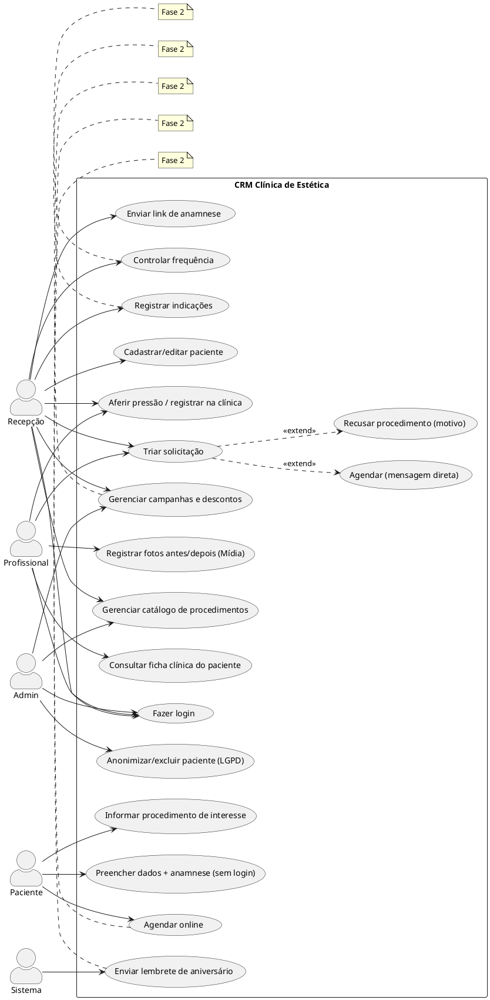
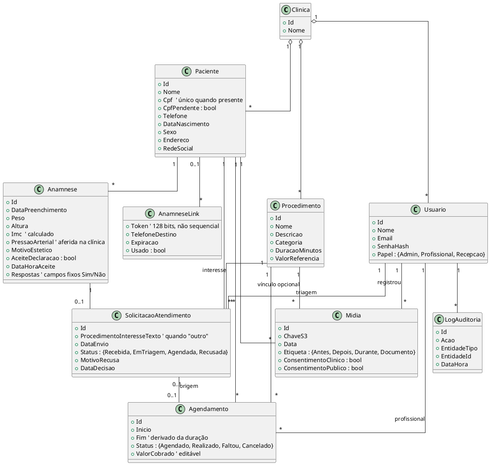
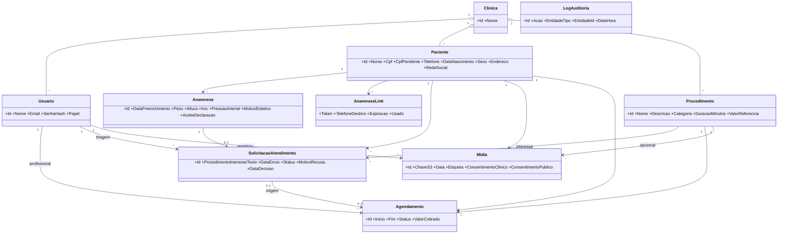
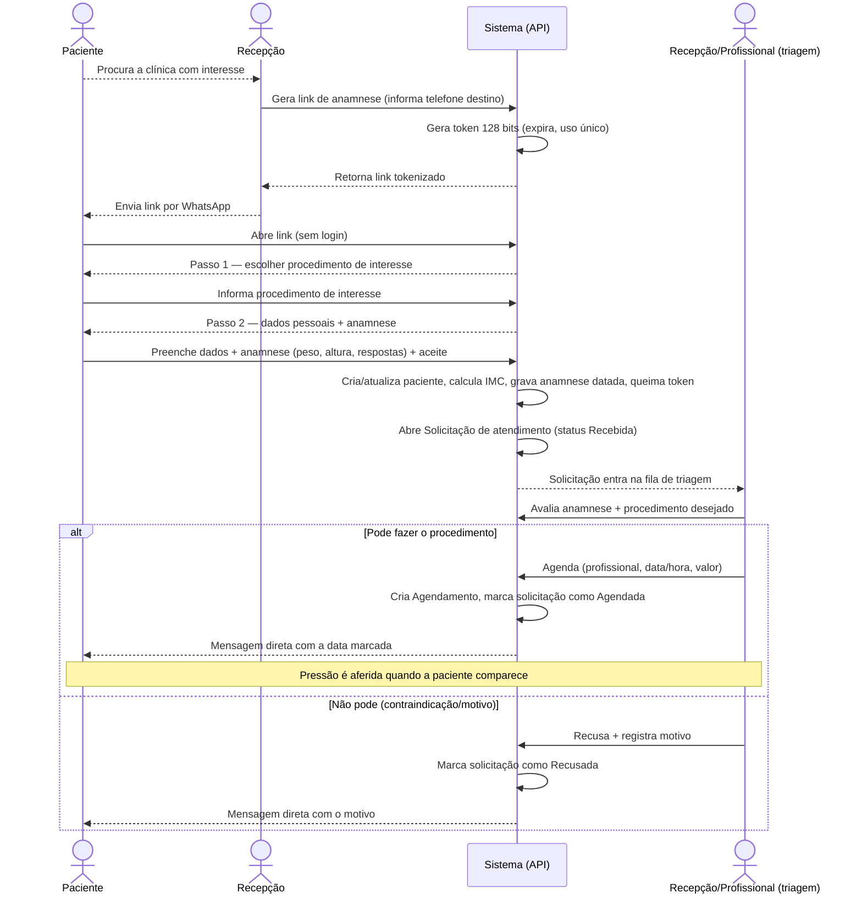
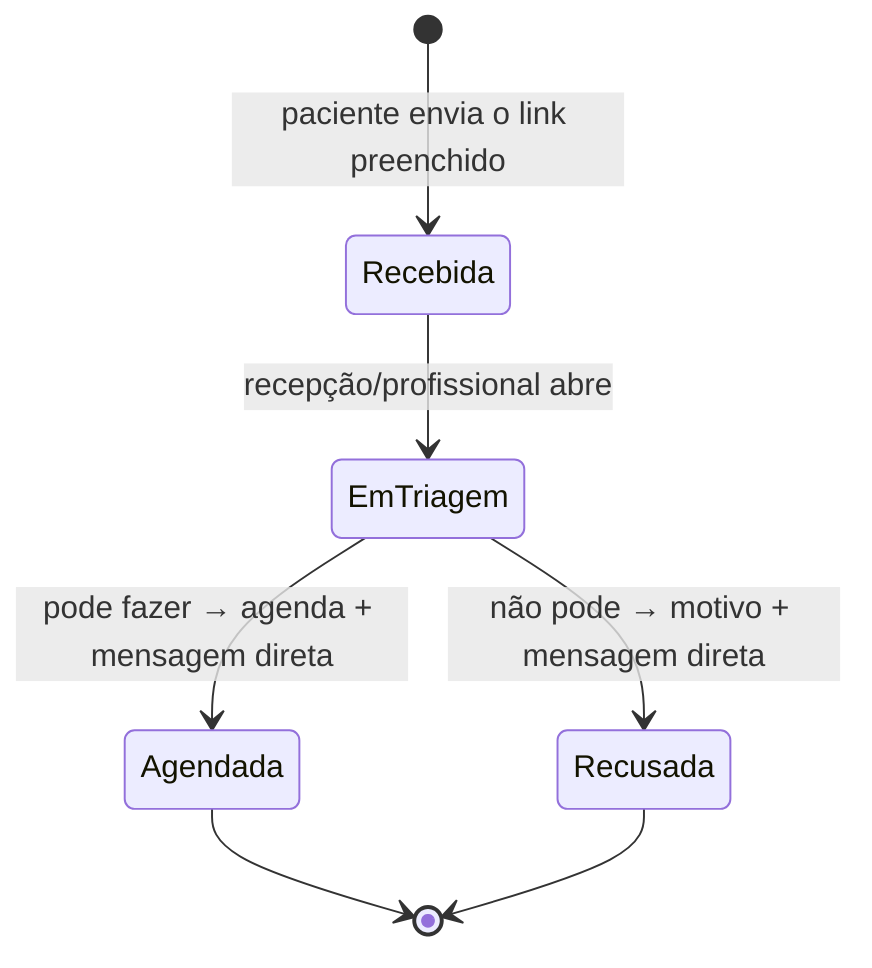
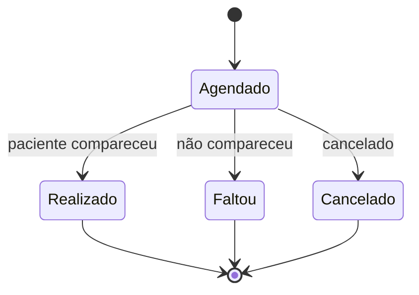

# Handoff — Diagramas UML do CRM da Clínica de Estética

> **Para quem lê isto (ex.: Claude no app / renderizador UML):**
> Este documento descreve, por escrito, como o sistema funciona e quem são os atores, **e já traz o código-fonte dos diagramas** em PlantUML e Mermaid. Sua tarefa é **produzir/desenhar os diagramas UML** a partir daqui: (1) Diagrama de Casos de Uso por ator, (2) Diagrama de Classes (modelo de dados), (3) Diagrama de Sequência do fluxo de entrada da paciente (intake + triagem), e (4) Diagramas de Estados da solicitação/triagem e do agendamento. Pode renderizar o código abaixo como está ou redesenhá-lo com um visual mais bonito, mantendo a semântica.

---

## 1. Resumo do sistema

CRM para uma **clínica de estética** (single-tenant, ~10 pessoas). Gerencia a captação da paciente por link, anamnese online, **triagem**, agenda dos profissionais, catálogo de procedimentos e fotos de antes/depois. Trata **dados sensíveis de saúde** (LGPD). O MVP é a **Fase 1**; há funcionalidades de Fase 2 e 3 marcadas.

**Fluxo de entrada (resumo):** a cliente demonstra interesse → a clínica envia um link de anamnese sem login → a paciente **informa o procedimento de interesse** e **preenche seus dados + anamnese** → o sistema abre uma **Solicitação de atendimento** → a recepção/profissional faz a **triagem** e decide **agendar** (mensagem direta com a data) ou **recusar** (motivo).

## 2. Atores / Papéis

- **Admin** (sócios): acesso total.
- **Profissional** (esteticistas): ficha clínica, anamnese, triagem, procedimentos, mídia, própria agenda.
- **Recepção**: envio da anamnese, **triagem** (agendar/recusar), cadastro, agenda, catálogo — **sem** acesso a dados clínicos sensíveis.
- **Paciente**: **sem login**; via link tokenizado informa o procedimento de interesse, preenche os próprios dados e a anamnese.
- **Sistema** (Fase 2): rotinas automáticas (ex.: lembrete de aniversário).

---

## 3. Diagrama de Casos de Uso (PlantUML)

---

## 4. Diagrama de Classes / Modelo de Dados (PlantUML)

> Todas as entidades principais carregam `ClinicaId` (preparo multi-tenant).

### 4.1 Mesmo modelo em Mermaid (alternativa)

---

## 5. Diagrama de Sequência — Entrada da Paciente (intake + triagem) (Mermaid)

---

## 6. Diagramas de Estados (Mermaid)

### 6.1 Solicitação de atendimento (triagem)

### 6.2 Agendamento

> Um agendamento nasce quando uma solicitação é **Agendada** na triagem (ou de forma avulsa).

---

## 7. O que pedir ao renderizador

1. Desenhar o **Diagrama de Casos de Uso** (seção 3), destacando visualmente o que é Fase 2.
2. Desenhar o **Diagrama de Classes** (seção 4), mostrando cardinalidades.
3. Desenhar o **Diagrama de Sequência** da entrada da paciente — intake + triagem (seção 5).
4. Desenhar os **Diagramas de Estados** — solicitação/triagem (6.1) e agendamento (6.2).

Ferramentas sugeridas para renderizar: PlantUML (plantuml.com), Mermaid Live Editor (mermaid.live), ou o próprio Claude no app.
